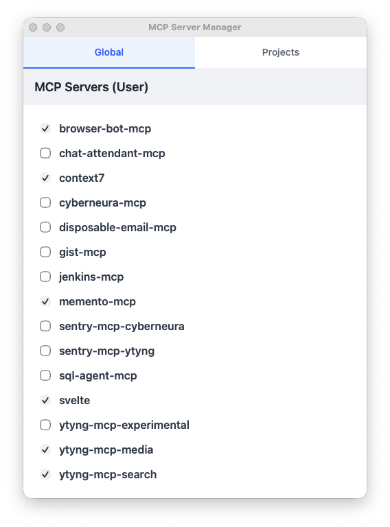

# MCP Server Manager


A desktop app to manage MCP server ON/OFF states by editing `~/.claude.json`.



## Install (macOS)

```bash
brew install --cask ytyng/tap/mcp-server-manager
```

Or download the dmg from [Releases](https://github.com/ytyng/mcp-server-manager/releases).

## Features

### Global Tab
- Move server configurations between `mcpServers` and `disabledMcpServers`
- Check ON: `disabledMcpServers` → `mcpServers`
- Check OFF: `mcpServers` → `disabledMcpServers`

### Projects Tab
- Filter and display project list
- Edit per-project `disabledMcpServers` array

## Tech Stack

### Frontend
- SvelteKit v2
- Svelte 5
- TypeScript
- Tailwind CSS v4
- svelte-sonner (toast notifications)

### Backend
- Tauri v2
- Rust
- serde_json (JSON manipulation)
- dirs (home directory resolution)

## Development

```bash
# Install dependencies
pnpm install

# Start development server
pnpm tauri dev
```

## Build

```bash
# Production build
pnpm tauri build
```

Artifacts:
- `src-tauri/target/release/bundle/macos/mcp-server-manager.app`
- `src-tauri/target/release/bundle/dmg/mcp-server-manager_x.x.x_aarch64.dmg`

## Release

The version in `src-tauri/tauri.conf.json` on `main` decides the release.
When it has no published GitHub Release yet, the `Release` workflow builds a
signed and notarized universal dmg and publishes it as `v<version>`.
The Homebrew tap picks up the new release within an hour.

```bash
pnpm release          # patch (default)
pnpm release minor
pnpm release major
```

Keep version bumps out of feature PRs: merging a PR that carries an
unreleased version publishes it.

## CLI Arguments

```bash
# Open with Projects tab as default + apply filter
mcp-server-manager --project=<filter>
mcp-server-manager -p <filter>
```

## Project Structure

```
src/
├── app.css                     # Tailwind CSS entry
├── lib/
│   ├── api.ts                  # Tauri command wrapper
│   ├── stores.ts               # Svelte stores
│   ├── types.ts                # TypeScript type definitions
│   └── components/
│       ├── GlobalSettings.svelte
│       ├── ProjectSettings.svelte
│       ├── ProjectCard.svelte
│       ├── ServerCheckbox.svelte
│       └── TabContainer.svelte
└── routes/
    ├── +layout.svelte
    └── +page.svelte

src-tauri/
├── src/
│   ├── lib.rs                  # Tauri entry point
│   ├── claude_config.rs        # JSON read/write utilities
│   └── commands.rs             # Tauri commands
├── icons/                      # App icons
├── Cargo.toml
└── tauri.conf.json
```
